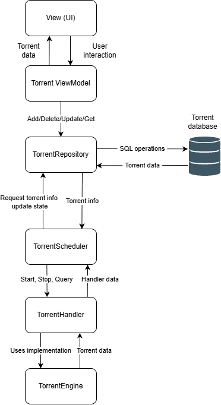

# Rendszerterv

## Platform, választott szoftverkészlet

A választott programozási nyelv a Kotlin lett, ami egy JVM-en (is) futtatható, magas szintű programozási nyelv.  
A végleges program egy Kotlin Multiplatform (KMP) alkalmazás, amely jelenleg kizárólag asztali számítógépen működik.  
A keretrendszernek köszönhetően használhatóvá vált a Jetpack Compose eszköztár (widgetek, Composable függvények), melyet a felhasználói felület elkészítéséhez használtunk.  
Az alkalmazás ezen felül különböző adatbázis-műveleteket végez egy SQLite adatbázison, amely a program munkakönyvtárában található `torrent.db` fájlban tárolódik, így az adatok az alkalmazás újraindítása után is megmaradnak.  
Az adatbázis-műveletekhez SQLDelight-ot használtunk, amely már meglévő SQL utasításokból generál típusbiztos Kotlin interfészt. (A követelményspecifikációban szereplő Room helyett azért esett erre a választás, mert az SQL séma és a lekérdezések így explicit módon, kézben tarthatóan írhatók meg.)  
Az alkalmazás, lévén hogy torrent kliens, különböző hálózati hívásokat végez (UDP socket nyitása, UDP datagram küldése, TCP kapcsolat a peerekkel stb.). A hálózati műveletek kezelésére a `java.net` modult használtuk, mivel relatíve alacsony szintű hálózati API-ra volt szükségünk, ez pedig pontosan ezt biztosította.  
A párhuzamos végrehajtáshoz Kotlin Coroutine-okat és Flow-t, illetve a hálózati réteg szintjén Java szálakat (thread pool) használunk.  
Végezetül build rendszernek Gradle-t használtunk, mivel relatíve egyszerű függőségkezelést biztosít, és jól együttműködik a különböző Java IDE-kkel.  
A program futtatásához legalább Java 21 szükséges.

## Rendszerarchitektúra

Az alábbi ábrán látható architektúrát használja a végleges program.



A konkrét komponensek és felelősségeik:

| Komponens | Felelősség |
|:---|---|
| View (UI) | A megjelenítésért felelős komponens, Compose keretrendszert használ. A felhasználó ezzel interaktál, ezen keresztül jutnak el a kérések az alacsonyabb szintekhez (azaz a ViewModelhez). |
| Torrent ViewModel | Adatot biztosít a View-nak, amit az meg tud jeleníteni (az adat lentebbi rétegből származik, a ViewModel csak a megfelelő formára hozza), illetve a felhasználói szándékot továbbítja a repository felé. |
| TorrentRepository | A mögöttes adatbázis-interakciót rejti el, rajta keresztül kérhetők le és módosíthatók az adatbázisban tárolt adatok. |
| TorrentScheduler | Torrent műveletek (seed, letöltés, szüneteltetés) indítását kezeli: torrentenként létrehoz egy TorrentHandlert, mely megvalósítja a ténylegesen elvégzendő műveletet. Egy általa generált TorrentContext objektumon keresztül adja át a handlernek a szükséges információkat, illetve callbackeket. |
| TorrentHandler | Magas szintű API-t biztosít, elrejtve ezzel a konkrét torrent-implementációt (TorrentEngine), ezen felül lekérdezhetők rajta keresztül a TorrentEngine bizonyos adatai (letöltés állapota, seed állapota stb.). |
| TorrentEngine | Alacsony szintű BitTorrent protokoll-implementáció: a peerek lekérdezése, a letöltés kezelése és a lemez I/O a feladata. |

Fontos tervezési döntés, hogy a ViewModel és a TorrentScheduler **nem hívják egymást közvetlenül**: kizárólag az adatbázison (TorrentRepository) keresztül kommunikálnak. A ViewModel a felhasználói szándékot a torrent `mode` mezőjébe írja, a Scheduler ezt olvassa ki és hajtja végre, majd a futó torrentek állapotát visszaírja az adatbázisba, ahonnan a ViewModel megjeleníti. Az adatbázis így az egész rendszer egyetlen igazságforrása (single source of truth), a két oldal pedig egymástól függetlenül fejleszthető és tesztelhető.

## Csomagstruktúra

A forráskód két Gradle modulból áll: a `desktopApp` modul csak az asztali belépési pontot tartalmazza, minden más logika a `shared` modulban van. A `shared` modulon belül a `commonMain` a platformfüggetlen kódot, a `jvmMain` a JVM-specifikus implementációkat tartalmazza (jelenleg csak az adatbázis-driver létrehozását).

```
src/
├── desktopApp/                         asztali belépési pont
│   └── org.vik.torrente
│       └── main.kt                     ablak létrehozása, TorrentRepository példányosítása
│
└── shared/
    ├── commonMain/
    │   ├── kotlin/org.vik.torrente
    │   │   ├── App.kt                  gyökér Composable, Scheduler és ViewModel összekötése
    │   │   ├── ui/                     ── View réteg
    │   │   │   ├── components/         képernyőelemek (lista, kártya, dashboard, hozzáadás dialógus)
    │   │   │   ├── model/              UI-oldali adatmodell (Torrent)
    │   │   │   ├── icons/, util/       ikonok, formázók
    │   │   ├── viewmodel/              ── ViewModel réteg (TorrentUIViewModel)
    │   │   ├── repository/             ── Repository réteg
    │   │   │   ├── TorrentRepository   adatbázis-kapcsolat
    │   │   │   ├── database/           DatabaseDriverFactory interfész
    │   │   │   ├── models/             adatbázis-modellek és enumok
    │   │   │   └── orm/                Insert/Select/Update/Delete műveletek
    │   │   ├── scheduler/              ── TorrentScheduler
    │   │   ├── torrent/                ── TorrentHandler, TorrentContext
    │   │   │   └── engine/             ── TorrentEngine és a protokoll részei
    │   │   │                              (tracker, handshake, peer kapcsolat, tárolás, metaadat)
    │   │   └── utils/                  bencode dekóder
    │   └── sqldelight/queries/         SQL séma (tables.sq) és lekérdezések, amikből az SQLDelight kotlin kódot generál
    └── jvmMain/
        └── repository/database/        JvmDatabaseDriverFactory (SQLite, torrent.db)
```

A csomagok közötti függőség egyirányú, és követi az architektúra-ábra rétegeit:

```
ui ──▶ viewmodel ──▶ repository ◀── scheduler ──▶ torrent ──▶ torrent.engine ──▶ utils
```

## Adatbázisséma

A szoftver 5 adatbázistáblát használ, melyek az alábbi ábrán láthatók.


| Tábla | Tartalom | Elsődleges kulcs | Idegen kulcsok |
|:---|---|---|---|
| `Torrents` | A felvett torrentek: info hash, tracker URL, név, teljes méret, állapot (`status`), kért működési mód (`mode`), a `.torrent` fájl útvonala és a letöltési könyvtár. | `hash` | – |
| `Files` | A torrentben szereplő fájlok (név, méret, sorszám). | (`torrent_hash`, `number`) | `torrent_hash` → `Torrents.hash` |
| `Pieces` | A torrent darabjai (piece-ek): SHA-1 hash, méret, sorszám, letöltési állapot és útvonal. | (`torrent_hash`, `number`) | `torrent_hash` → `Torrents.hash` |
| `Peers` | Az adott torrenthez éppen kapcsolódó peerek (cím, azonosító, állapot). | (`id_hash`, `torrent_hash`) | `torrent_hash` → `Torrents.hash` |
| `PeerHasPiece` | Kapcsolótábla: melyik peer melyik darabbal rendelkezik. | (`peer_id_hash`, `piece_number`, `torrent_hash`) | → `Peers`, → `Pieces`, → `Torrents` |

Az egész számként tárolt állapotmezők a `repository/models` csomag enumjainak sorszámát (ordinal) tartalmazzák:

| Mező | Enum | Lehetséges értékek (0-tól) |
|:---|---|---|
| `Torrents.status` | `TorrentStatusModel` | CHECKING, STARTING, DOWNLOADING, SEEDING, PAUSED, COMPLETED, STOPPED, ERROR |
| `Torrents.mode` | `TorrentModeModel` | INACTIVE, DOWNLOADING, SEEDING, DOWNLOADING_AND_SEEDING, PAUSED_DOWNLOADING, PAUSED_DOWNLOADING_AND_SEEDING, PAUSED_SEEDING |
| `Pieces.status` | `PieceStatus` | AVAILABLE, NOT_AVAILABLE, DOWNLOADING |
| `Peers.status` | `PeerStatus` | SEEDING, LEECHING, SEEDING_AND_LEECHING, INACTIVE |

A `mode` mező a felhasználó szándékát (mit *kell* csinálni a torrenttel), a `status` mező a tényleges állapotot (mit csinál *éppen*) írja le. Előbbit a ViewModel, utóbbit a Scheduler írja.

## Futás közbeni működés

### Indulás

1. A `main.kt` létrehozza az ablakot és a `TorrentRepository`-t, amely a `JvmDatabaseDriverFactory` segítségével megnyitja (szükség esetén létrehozza) a `torrent.db` adatbázist.
2. Az `App` Composable létrehozza a `TorrentScheduler`-t és elindítja, valamint létrehozza a `TorrentUIViewModel`-t. Az ablak bezárásakor a Scheduler leáll.
3. A Scheduler egy közös `PeerListener`-t nyit, amelyen keresztül más peerek kapcsolódhatnak hozzánk; ezen minden futó torrent osztozik.

### Folyamatosan futó ciklusok

- **ViewModel:** 500 ms-onként beolvassa az adatbázisból a torrenteket a hozzájuk tartozó fájlokkal, darabokkal és peerekkel, majd egy `StateFlow`-n keresztül átadja a View-nak, amely ennek hatására újrarajzolódik.
- **Scheduler:** egy külön szálon 50 ms-onként végignézi az adatbázisban lévő torrenteket, és összeveti a `mode` mezőt a futó handlerekkel:
  - aktív módú (DOWNLOADING, SEEDING, DOWNLOADING_AND_SEEDING) torrenthez, amelynek még nincs handlere → új `TorrentHandler` indul;
  - PAUSED_* mód → `Pause` parancs, aktív mód egy szüneteltetett handlerre → `Resume` parancs;
  - INACTIVE mód egy futó handlerre → `Stop` parancs.
  
  Minden 5. ciklusban (kb. 250 ms) a futó handlerek pillanatnyi állapotát (letöltött és letöltés alatt álló darabok, kapcsolódó peerek) visszaírja az adatbázisba.

A Scheduler a handlerekkel a `TorrentContext`-en keresztül kommunikál: a parancsok egy `Channel`-en jutnak el a handlerhez, a handler pedig callbackeken (`onComplete`, `onStop`) jelzi vissza a befejezést vagy a leállást.

### Egy torrent életciklusa

1. **Hozzáadás:** a felhasználó a hozzáadás dialógusban kiválaszt egy `.torrent` fájlt és egy letöltési könyvtárat. A ViewModel a bencode dekóderrel feldolgozza a fájlt, majd egyetlen műveletben beszúrja a `Torrents`, `Files` és `Pieces` sorokat a kért móddal.
2. **Indítás:** a Scheduler következő ciklusa észreveszi az aktív módot, és elindít egy `TorrentHandler`-t egy saját coroutine-ban (`Dispatchers.IO`), amelynek átad egy újonnan létrehozott `TorrentContext`-et.
3. **Ellenőrzés (CHECKING):** a handler létrehozza a `TorrentEngine`-t, amely a letöltési könyvtárban már meglévő adatokat hash alapján ellenőrzi, így a helyes darabokat nem kell újra letölteni.
4. **Kapcsolódás (STARTING):** az engine a trackertől lekéri a peerek listáját, és elkezd hozzájuk kapcsolódni.
5. **Letöltés / seedelés (DOWNLOADING / SEEDING):** az engine párhuzamosan tölti le a darabokat a peerektől, ellenőrzi őket, kiírja a lemezre, és közben a nálunk meglévő darabokat kiszolgálja a többi peernek. Ha elfogynak a peerek, 30 másodperc múlva, egyébként 30 percenként újra lekérdezi a trackert.
6. **Szüneteltetés:** `Pause` hatására a handler bontja az összes peerkapcsolatot, de megjegyzi a meglévő darabokat; `Resume` esetén ellenőrzés nélkül folytatja.
7. **Befejezés:** ha minden darab megvan, DOWNLOADING módban a handler leáll (állapot: COMPLETED, mód: INACTIVE), DOWNLOADING_AND_SEEDING módban pedig a Scheduler SEEDING módra állítja a torrentet, és a seedelés folytatódik.
8. **Leállítás, hiba, törlés:** leálláskor a Scheduler kitörli a torrent peerjeit az adatbázisból, a mód INACTIVE lesz. Hiba esetén az állapot ERROR, és a darabok állapota visszaáll NOT_AVAILABLE-re. Törléskor a ViewModel először INACTIVE-ra állítja a torrentet (ez leállítja a handlert), majd törli az adatbázisból.

### Párhuzamosság

| Végrehajtási egység | Feladat |
|:---|---|
| UI szál | Compose megjelenítés, felhasználói események |
| ViewModel coroutine (`viewModelScope`, `Dispatchers.IO`) | Adatbázis periodikus olvasása, felhasználói műveletek beírása |
| Scheduler szál (`DBListener`) | Adatbázis figyelése, handlerek indítása és vezérlése, állapot visszaírása |
| Handler coroutine (torrentenként egy, `Dispatchers.IO`) | Egy torrent életciklusának vezérlése, parancsok feldolgozása |
| Engine thread pool (torrentenként) | Kimenő peerkapcsolatok (legfeljebb 10), plusz legfeljebb 20 bejövő kapcsolat |
| `PeerListener` szál (közös) | Bejövő peerkapcsolatok fogadása és a megfelelő torrenthez irányítása az info hash alapján |

A megosztott állapotot az engine egy zárral (`synchronized`), a Scheduler a handlerek szinkronizált listájával védi.

## BitTorrent protokoll

A hálózati réteg a szabványos BitTorrent protokollt valósítja meg, ezért annak részleteit itt nem ismertetjük, csak azt, hogy mely részeit implementáltuk, amely az alábbi táblázatban látható.

| Rész | Specifikáció | Megvalósítás |
|:---|---|---|
| Bencode kódolás, `.torrent` metaadat-fájl, info hash | [BEP 3](https://www.bittorrent.org/beps/bep_0003.html) | `utils/bencode.kt`, `engine/TorrentMetadata.kt` |
| Peer wire protokoll (TCP): handshake, üzenetek, choke/unchoke, darabok kérése és küldése | [BEP 3](https://www.bittorrent.org/beps/bep_0003.html) | `engine/Handshake.kt`, `engine/PeerConnection.kt`, `engine/TorrentEngine.kt` |
| UDP tracker protokoll (connect, announce) | [BEP 15](https://www.bittorrent.org/beps/bep_0015.html) | `engine/Connect.kt`, `engine/Announce.kt`, `engine/UdpTracker.kt` |
| Darabok ellenőrzése SHA-1 hash-sel | [BEP 3](https://www.bittorrent.org/beps/bep_0003.html), [RFC 3174](https://www.rfc-editor.org/rfc/rfc3174) | `engine/TorrentEngine.kt` |

Csak UDP trackereket támogatunk.
