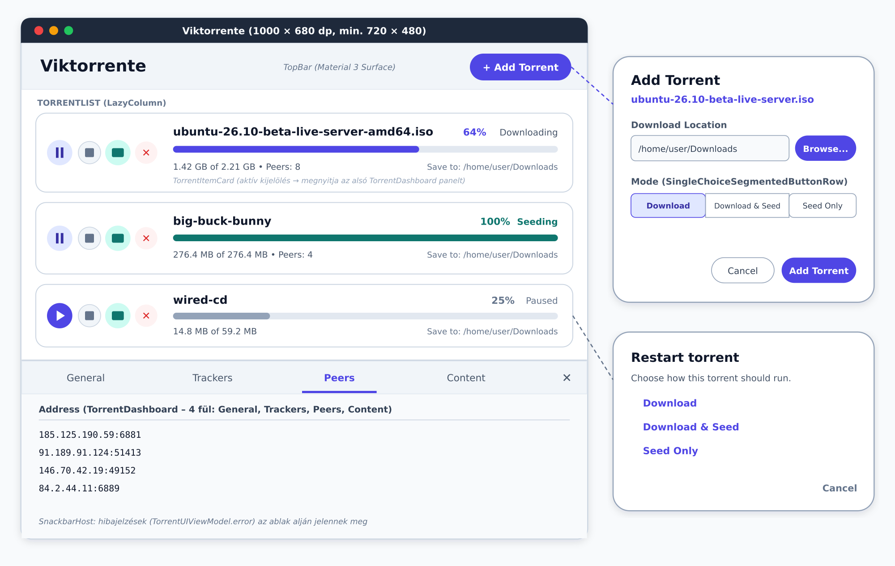
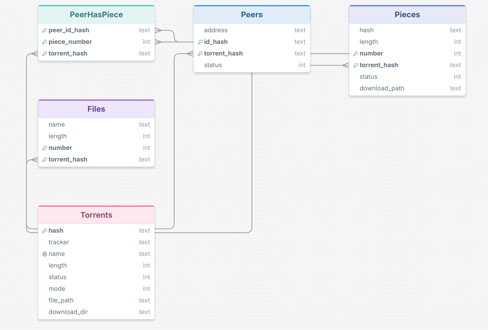
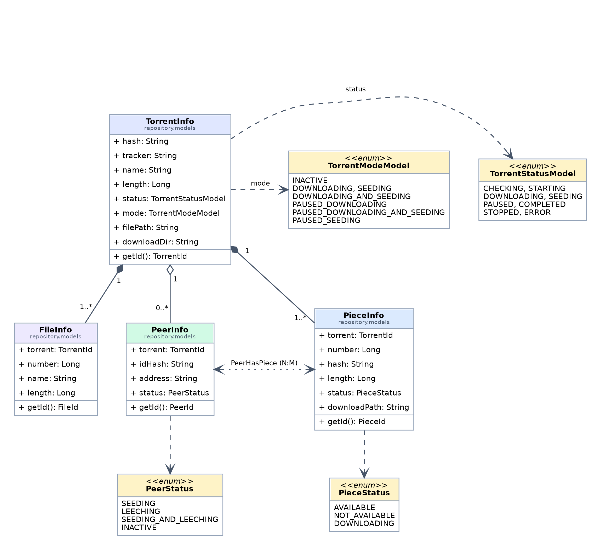
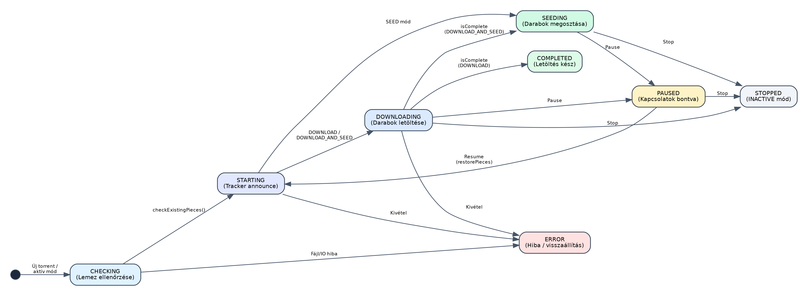

\newpage

# 1. A rendszer célja, funkciói és környezete

## 1.1 Feladatkiírás

A projekt célja egy modern, több operációs rendszeren (Windows, Linux, macOS) futtatható, asztali **BitTorrent kliens** (**Viktorrente**) megtervezése és elkészítése **Kotlin Multiplatform (KMP)** és **Compose Multiplatform (CMP)** technológiák felhasználásával. Az alkalmazás átlátható, reszponzív grafikus felületet biztosít a peer-to-peer (P2P) alapú fájlmegosztáshoz, a `.torrent` metaadat-fájlok feldolgozásától a több szálon párhuzamosított letöltésen és SHA-1 alapú darabellenőrzésen át egészen a már letöltött állományok megosztásáig (seedelés).

A letöltött tartalmak (videók, archívumok, lemezképek stb.) tényleges megnyitása és megjelenítése az operációs rendszer fájlböngészőjének és külső alkalmazásainak feladata, nem képezi jelen projekt részét; a Viktorrente mindössze a letöltési könyvtár megnyitását kezdeményezi az operációs rendszernél. A feladat funkcionális követelményeinek kiindulási leírása a követelményspecifikációban (`specification.md`) olvasható.

### A fejlesztői csapat

A projekt megvalósítását a következő csapat végezte a *Szoftverarchitektúrák* tantárgy házi feladatának keretében:

| Név | Neptun-kód | E-mail cím |
|:---|:---|:---|
| Abonyi Bence Péter | D10QTW | bence.abonyi@edu.bme.hu |
| Kovács Nimród Ányos | CZ4WH5 | kovacsnimrodanyos@edu.bme.hu |
| Tóth Máté | XBVV06 | tothmate04@edu.bme.hu |
| Szobek Ádám Márk | RV30LP | szobek69420@edu.bme.hu |

## 1.2 A rendszer által biztosított fő funkciók

Az elkészített alkalmazás a következő fő funkciócsoportokat valósítja meg a felhasználók számára:

- **Torrentek importálása és validálása:**
  - `.torrent` metaadat-fájlok kiválasztása natív fájlválasztó ablakon keresztül (FileKit).
  - Bencode formátumú metaadatok dekódolása, az `info` szótár SHA-1 hash-ének (info hash) kiszámítása, egyfájlos és többfájlos torrentek struktúrájának feldolgozása, valamint a tracker-lista (`announce` és `announce-list`) beolvasása.
  - Letöltési célkönyvtár és kezdeti futtatási mód (*Download*, *Download & Seed*, *Seed Only*) kiválasztása dialógusablakban.
  - Duplikált torrentek felvételének megakadályozása info hash alapján.
- **Letöltés (leechelés) és darabellenőrzés:**
  - A célkönyvtárban már meglévő fájlok darabszintű (piece) SHA-1 ellenőrzése indításkor, így a megszakított vagy már létező letöltések újratöltés nélkül folytathatók.
  - Peerek felderítése UDP trackereken keresztül (BEP 15: `connect` és `announce` üzenetváltás).
  - Párhuzamos TCP peer wire kapcsolatok kezelése (BEP 3), 16 KiB-os blokkok pipelined igénylése, összeállított darabok SHA-1 hash alapú hitelesítése és lemezre írása.
- **Megosztás (seedelés):**
  - Közös bejövő TCP figyelőport (`PeerListener`) üzemeltetése, amely a handshake-ben szereplő info hash alapján irányítja a beérkező peereket a megfelelő futó torrenthez.
  - Más kliensek blokk-kéréseinek kiszolgálása feltöltési slot-kezeléssel (choke/unchoke).
  - *Download & Seed* módban automatikus átváltás seedelésre a letöltés 100%-os befejezésekor.
- **Munkamenetek vezérlése és perzisztálása:**
  - Torrentek szüneteltetése (*Pause*) és folytatása (*Resume*) a már hitelesített darabok memóriában tartásával, újbóli lemezellenőrzés nélkül.
  - Torrentek teljes leállítása (*Stop*) és újraindítása tetszőleges üzemmódban.
  - Torrentek eltávolítása a nyilvántartásból (*Delete*) a kapcsolódó fájl-, darab- és peer-rekordokkal együtt.
  - A célkönyvtár közvetlen megnyitása az operációs rendszer alapértelmezett fájlkezelőjében.
- **Részletes diagnosztikai nézet (`TorrentDashboard`):**
  - Egy kiválasztott torrenthez tartozó alsó részletező panel 4 füllel: *General* (mentési útvonal, letöltött/teljes méret, darabszám, státusz), *Trackers* (konfigurált tracker URL-ek), *Peers* (elérhető peerek címei) és *Content* (a torrentben szereplő fájlok útvonala és mérete).

## 1.3 A program működési környezete

A Viktorrente önálló asztali vastagkliens (desktop thick client) alkalmazás, amely futtatásához nem igényel külső adatbázis-szervert vagy háttérszolgáltatást. A platformfüggetlenséget a **Java Virtual Machine (JVM, legalább Java 21)** és a **Compose Multiplatform Desktop** grafikus keretrendszer biztosítja; az alkalmazás Windows és Linux rendszereken egyaránt futtatható (és a csomagolási konfiguráció macOS `.dmg` csomagolást is támogat).

A rendszer három külső alrendszerrel áll kapcsolatban:

1. **Helyi fájlrendszer és operációs rendszer:** a `.torrent` fájlok beolvasása, a letöltött tartalmak véletlen elérésű írása/olvasása (`RandomAccessFile`), az SQLite adatbázis tárolása, továbbá a célkönyvtár megnyitása a `java.awt.Desktop` interfészen keresztül.
2. **UDP tracker szerverek:** szabványos BEP 15 alapú UDP datagram kommunikáció a swarm peereinek felderítéséhez és az állapotváltozások (`started`, `completed`, `stopped`) jelentéséhez.
3. **BitTorrent peerek:** szabványos BEP 3 alapú TCP kapcsolatok (kimenő és bejövő irányban egyaránt) adatblokkok és állapotüzenetek cseréjéhez.

## 1.4 Platform és választott szoftverkészlet

Az alkalmazás fejlesztéséhez választott fő technológiák és a választások indoklása:

- **Kotlin és Kotlin Multiplatform (KMP, Kotlin 2.4.20):** A Kotlin modern, null-biztos, tömör szintaxisú, JVM-en futó nyelv, amely kiválóan együttműködik a Java ökoszisztémával. A KMP struktúra (`shared/commonMain` és `shared/jvmMain`) lehetővé teszi az üzleti logika és a UI platformfüggetlen elkülönítését, megalapozva a későbbi többplatformos (pl. Android) bővíthetőséget.
- **Compose Multiplatform (1.12.1) és Material 3:** Deklaratív felhasználói felületi keretrendszer, amely reaktív állapotkezeléssel (`StateFlow` + `collectAsState`) teszi egyszerűvé a gyakran frissülő letöltési állapotok és előrehaladás-jelzők megjelenítését. A Material 3 (Material You) eszközkészlet automatikusan támogatja a rendszer világos és sötét témáját.
- **SQLite és SQLDelight (2.0.1):** A helyi adatperzisztáláshoz kiszolgáló nélküli SQLite adatbázist választottunk, amely egyetlen fájlban (`torrent.db`) képes tárolni a teljes alkalmazásállapotot. A követelményspecifikációban eredetileg megemlített Room helyett az **SQLDelight** mellett döntöttünk, mert SQL-first megközelítéssel, kézzel írt `.sq` fájlokból fordítási időben generál típusbiztos Kotlin API-t, miközben teljes kontrollt ad az SQL séma, az összetett elsődleges kulcsok és a külső kulcsok felett, továbbá természetesen illeszkedik a KMP `commonMain` modulba.
- **`java.net` hálózati API:** A BitTorrent protokoll bináris UDP datagramokat (tracker) és hosszelőtaggal ellátott TCP adatfolyamokat (peer wire) használ. A standard `java.net` (`Socket`, `ServerSocket`, `DatagramSocket`) és `java.nio.ByteBuffer` osztályok közvetlen, alacsony szintű és külső függőségektől mentes vezérlést biztosítanak a bájtsorrend (big-endian) és az időtúllépések felett.
- **Kotlin Coroutines, Flow és Java Thread Pool:** A felsőbb rétegek (UI, ViewModel, `TorrentHandler`) aszinkron eseményvezérlését Kotlin Coroutine-ok, `Channel`-ek és `StateFlow`-k látják el, míg az alacsony szintű, blokkoló socket-műveleteket végző hálózati rétegben dedikált Java szálakat és fix méretű `ExecutorService` szálkészletet használunk.
- **FileKit (0.8.8):** Natív, platformfüggetlen fájl- és könyvtárválasztó dialógusok biztosítása Compose Multiplatform alkalmazásokhoz.
- **Gradle (Kotlin DSL + Version Catalog):** Egységes függőségkezelés (`libs.versions.toml`), SQLDelight kódgenerálás, tesztfuttatás és futtatható uber-JAR / natív telepítőcsomagok előállítása.


# 2. Rendszerarchitektúra és modulok

## 2.1 Áttekintő architektúra

A Viktorrente többrétegű, lazán csatolt architektúrát valósít meg, amelynek központi eleme az **adatbázis mint egyetlen igazságforrás (Single Source of Truth)**. A végleges program komponensdiagramja az 1. ábrán látható.

{ width=44% }

Az egyes komponensek felelősségi körét az alábbi táblázat foglalja össze:

| Komponens | Réteg | Felelősség |
|:---|:---|:---|
| **View (UI)** | Megjelenítés | Jetpack Compose felületi elemek megjelenítése és felhasználói események (hozzáadás, szüneteltetés, folytatás, leállítás, törlés, mappa megnyitása) továbbítása a ViewModel felé. |
| **TorrentUIViewModel** | Prezentációs logika | A repository-ból kiolvasott adatokat UI-kompatibilis modellé alakítja (`StateFlow`), parszolja és validálja az új `.torrent` fájlokat, valamint a felhasználói szándékot a torrent `mode` mezőjébe írja. |
| **TorrentRepository** | Adathozzáférés | Elrejti az SQLite / SQLDelight alacsony szintű adatbázis-kezelését; típusbiztos CRUD és tranzakcionális műveleteket nyújt mind a ViewModel, mind a Scheduler számára. |
| **TorrentScheduler** | Ütemezés | Háttérszálon figyeli az adatbázisban tárolt torrentek kért módját (`mode`), elindítja vagy vezérli a torrentenkénti `TorrentHandler` példányokat, megoszt egy közös `PeerListener`-t, és rendszeresen visszaírja a futási állapotot az adatbázisba. |
| **TorrentHandler** | Munkamenet-vezérlés | Magas szintű, parancsvezérelt API-t biztosít egyetlen torrent munkamenetéhez: elrejti a `TorrentEngine`-t, kezeli a pause/resume állapotmegőrzést, az időszakos tracker-újrajelentést és a befejezési/leállási callbackeket. |
| **TorrentEngine** | Protokoll és I/O | Alacsony szintű BitTorrent protokoll-implementáció (BEP 3, BEP 12, BEP 15): tracker announce, kimenő/bejövő peer-kapcsolatok, darabütemezés, SHA-1 ellenőrzés, feltöltési slot-kezelés és többfájlos lemez I/O. |

### Kulcsfontosságú tervezési döntés: adatbázis-alapú szétválasztás

A rendszer egyik legfontosabb architekturális elve, hogy a **ViewModel és a TorrentScheduler nem hívják egymást közvetlenül** – közöttük kizárólag a `TorrentRepository` (és az alatta lévő SQLite adatbázis) közvetít:

- A **felhasználói szándékot** (mit *kell* tenni a torrenttel: letölteni, seedelni, szüneteltetni, leállítani) a ViewModel a `Torrents.mode` oszlopba írja.
- A **tényleges futási állapotot** (mit csinál *éppen* a motor, mely darabok érhetők el, milyen peerek ismertek) a Scheduler olvassa ki a futó handlerekből és írja vissza a `Torrents.status`, `Pieces` és `Peers` táblákba.

Ennek az aszinkron, állapot-rekonciliációs (state reconciliation) mintának köszönhetően a prezentációs oldal (UI + ViewModel) és a háttérfeldolgozó oldal (Scheduler + Engine) egymástól függetlenül fejleszthető, tesztelhető és cserélhető, továbbá az adatbázis bármely pillanatban konzisztens képet ad a rendszer állapotáról.

A csomagok közötti függőségek egyirányúak, körkörös hivatkozások nélkül:

```text
ui ──▶ viewmodel ──▶ repository ◀── scheduler ──▶ torrent ──▶ torrent.engine ──▶ utils
```

## 2.2 Csomagstruktúra és Gradle modulok

A forráskód két Gradle modulra tagolódik az `src/` könyvtár alatt:

- **`desktopApp`:** kizárólag az asztali JVM belépési pontot (`main.kt`), az operációs rendszerrel integrálódó segédfüggvényeket (mappa megnyitása, alapértelmezett `Downloads` könyvtár meghatározása), valamint az alkalmazásikonokat (`icon.png`, `viktorrente.ico`, `viktorrente.icns`) és a Compose Desktop csomagolási beállításokat tartalmazza.
- **`shared`:** a teljes többplatformos alkalmazáslogikát foglalja magában. A `commonMain` forráskészletben helyezkedik el a UI, a ViewModel, a Repository/ORM, a Scheduler, a BitTorrent motor és az SQLDelight `.sq` definíciók; a `jvmMain` forráskészlet a JVM-specifikus SQLite driver-gyárat (`JvmDatabaseDriverFactory`), míg a `jvmTest` a repository- és motor-teszteket tartalmazza.

```text
src/
├── desktopApp/
│   └── src/main/kotlin/org/vik/torrente/
│       └── main.kt                      Asztali belépési pont, ablak és Repository
└── shared/
    └── src/
        ├── commonMain/
        │   ├── kotlin/org/vik/torrente/
        │   │   ├── App.kt               Gyökér Composable, Scheduler + ViewModel
        │   │   ├── ui/                  View réteg (Material 3)
        │   │   │   ├── components/      TopBar, TorrentList, Card, Dashboard, Dialog
        │   │   │   ├── model/           UI adatmodellek (Torrent, Peer, Tracker, File)
        │   │   │   ├── icons/           Vektoros ikonok (AppIcons)
        │   │   │   └── util/            Méret- és sebességformázók (Formatters)
        │   │   ├── viewmodel/           TorrentUIViewModel
        │   │   ├── repository/          TorrentRepository
        │   │   │   ├── database/        DatabaseDriverFactory interfész
        │   │   │   ├── models/          DB entitások és állapot-enumok
        │   │   │   └── orm/             Insert, Select, Update, Delete műveletek
        │   │   ├── scheduler/           TorrentScheduler és DBListener
        │   │   ├── torrent/             TorrentHandler, TorrentContext, DummyTrackerAndPeer
        │   │   │   └── engine/          TorrentEngine, PeerConnection, PeerListener,
        │   │   │                        PieceStorage, TorrentMetadata, UdpTracker,
        │   │   │                        Connect, Announce, Handshake
        │   │   └── utils/               Bencode dekóder/enkóder és infoHash
        │   └── sqldelight/queries/      tables.sq, insert.sq, select.sq, update.sq,
        │                                delete.sq, test.sq
        ├── jvmMain/kotlin/org/vik/torrente/repository/database/
        │   └── JvmDatabaseDriverFactory.kt
        └── jvmTest/kotlin/org/vik/torrente/
            ├── TorrentHandlerTest.kt
            └── repository/
                ├── TorrentRepositoryTest.kt
                └── database/DummyDatabaseDriverFactory.kt
```

## 2.3 Rétegek részletes bemutatása

### 2.3.1 Adatbázis réteg

**Célja:** az alkalmazás strukturált adatainak (torrentek, fájlok, darabok, peerek és darab-felajánlások) lokális, megbízható perzisztálása külső adatbázis-szerver nélkül.

**Megjelenés a kódban:** `org.vik.torrente.repository.database` (`DatabaseDriverFactory` interfész a `commonMain`-ben, `JvmDatabaseDriverFactory` a `jvmMain`-ben) és `sqldelight/queries/tables.sq`.

**Működés és tervezési döntések:**

- A platformfüggő adatbázis-kapcsolat létrehozását a `DatabaseDriverFactory` interfész (`fun create(): SqlDriver`) választja le a `TorrentRepository`-ról. Ez egyrészt biztosítja a KMP kompatibilitást, másrészt lehetővé teszi, hogy a tesztek a `DummyDatabaseDriverFactory` segítségével izolált, memóriabeli SQLite adatbázissal fussanak.
- A JVM implementáció a `JdbcSqliteDriver` drivert használja bekapcsolt idegenkulcs-ellenőrzéssel (`foreign_keys = true`), és az adatbázis megnyitásakor létrehozza a sémát (`TorrentDB.Schema.create(driver)`), amennyiben a táblák még nem léteznek (`CREATE TABLE IF NOT EXISTS`).
- A perzisztens üzemi konfiguráció a program munkakönyvtárában elhelyezkedő `torrent.db` fájlra (`jdbc:sqlite:torrent.db`) támaszkodik (fejlesztői/tesztelési célra a driver gyárban az `IN_MEMORY` mód is támogatott).

### 2.3.2 Adathozzáférési réteg (Repository és ORM)

**Célja:** az SQLDelight által generált lekérdezések elfedése, a nyers adatbázissorok domain modellekre (`TorrentInfo`, `FileInfo`, `PieceInfo`, `PeerInfo`) való leképezése, valamint a több táblát érintő atomikus tranzakciók biztosítása.

**Megjelenés a kódban:** `org.vik.torrente.repository.TorrentRepository`, `org.vik.torrente.repository.orm.*` (`InsertQueryHandler.kt`, `SelectQueryHandler.kt`, `UpdateQueryHandler.kt`, `DeleteQueryHandler.kt`) és a `sqldelight/queries/*.sq` fájlok.

**Főbb szolgáltatások:**

A `TorrentRepository` tartja a `SqlDriver` és a generált `TorrentDB` példányt; a konkrét műveleteket tematikus kiterjesztésfüggvények (Kotlin extension functions) valósítják meg négy külön fájlban:

| Kategória | Főbb műveletek (`TorrentRepository.*`) | Szerep / tranzakciós viselkedés |
|:-----------------------|:-------------------------------------|:----------------------------------------|
| **Beszúrás** (`InsertQueryHandler`) | `insertTorrent`, `insertFile`, `insertPiece`, `insertPeer`, `insertPeerOffering`, `insertTorrentFullData` | Az `insertTorrentFullData` egyetlen `db.transactionWithResult` blokkban szúrja be a torrentet és összes fájlját, darabját, peerjét; bármely hiba esetén teljes `rollback(false)` történik. |
| **Lekérdezés** (`SelectQueryHandler`) | `getTorrents`, `getTorrentById`, `getTorrentByName`, `getTorrentsByFilename...`, `getFilesByTorrent`, `getPiecesByTorrent`, `getPeersByTorrent`, `getPiecesByPeer`, `getPeersByPiece`, `get*ById`, `get*Array` | A sorokat típusbiztos modellekre és enumokra (`entries[ordinal]`) képezi le; a `PeerHasPiece` kapcsolótáblán `INNER JOIN` lekérdezéseket támogat. |
| **Módosítás** (`UpdateQueryHandler`) | `updateTorrent`, `updatePiece`, `updateFile`, `updatePeer`, `updatePeerOffering` | Minden frissítés tranzakcióban fut, és a `SELECT changes()` lekérdezéssel ellenőrzi, hogy pontosan egy sor módosult-e. Az `updatePeerOffering` atomikusan cseréli egy peer felajánlott darabjait. |
| **Törlés** (`DeleteQueryHandler`) | `deleteTorrent`, `deleteFile`, `deletePiece`, `deletePeer`, `deletePeerPieceOffers` | A külső kulcsok (`foreign_keys = true`) sérülésének elkerülése érdekében a `deleteTorrent` tranzakcióban, függőségi sorrendben törli előbb a `PeerHasPiece`, `Pieces`, `Files` és `Peers` sorokat, majd magát a `Torrents` rekordot. |

Az SQL lekérdezések paraméterezettek (`:torrent_hash`, `:number` stb.), így az SQL-injekció kizárt, a lekérdezések szintaxisát és típushelyességét pedig az SQLDelight Gradle plugin már fordítási időben ellenőrzi.

### 2.3.3 Ütemező réteg (`TorrentScheduler`)

**Célja:** a háttérben futó torrent-munkamenetek teljes életciklusának összehangolása az adatbázis tartalmával, a felhasználói vezérlőparancsok továbbítása a megfelelő handlereknek, valamint az élő állapotok visszaírása a repository-ba.

**Megjelenés a kódban:** `org.vik.torrente.scheduler.TorrentScheduler`.

**Működés:**

- **Közös bejövő figyelő:** a `TorrentScheduler` példányosít egyetlen, minden futó torrent által megosztott `PeerListener(0)` objektumot, amely egy szabad operációsrendszer-porton fogadja a bejövő peer-kapcsolatokat.
- **Aktív handlerek nyilvántartása:** a futó és szüneteltetett munkameneteket a `Collections.synchronizedList` által védett `handlers: MutableList<HandlerData>` lista tárolja (`handler`, `context`, `paused`).
- **`DBListener` figyelőszál:** a `start()` metódus elindít egy dedikált háttérszálat (`DBListener : Thread`), amely `50 ms`-os ciklusokban beolvassa a `repository.getTorrents()` listát, és minden torrent `mode` mezőjét összeveti a memóriában nyilvántartott handlerrel:
  - Ha **még nincs handler**, és `mode` aktív (`DOWNLOADING`, `SEEDING`, `DOWNLOADING_AND_SEEDING`): létrehoz egy új `TorrentContext`-et és `TorrentHandler`-t, majd elindítja azt `CoroutineScope(Dispatchers.IO)` környezetben.
  - Ha **már létezik handler**:
    - aktív `mode` esetén (ha `paused == true`) → `TorrentCommand.Resume`;
    - `PAUSED_*` mód esetén (ha `paused == false`) → `TorrentCommand.Pause`;
    - `INACTIVE` mód esetén → `TorrentCommand.Stop`.
- **Periodikus állapot-visszaírás:** minden 5. ciklusban (kb. `250 ms`-onként) az `updateRepository()` lekéri minden aktív handler pillanatfelvételét (`torrentSnapshot()`), frissíti a torrent státuszát, szinkronizálja a `Peers` táblát, valamint a `piecesDownloaded` és `piecesDownloading` bitmezők alapján frissíti a `Pieces` rekordok státuszát (`AVAILABLE`, `DOWNLOADING`, `NOT_AVAILABLE`).
- **Callback-kezelés:**
  - `onTorrentComplete`: `DOWNLOAD_AND_SEED` módban átállítja a torrent `mode` és `status` mezőjét `SEEDING`-re, így a letöltés után a megosztás megszakítás nélkül folytatódik.
  - `onTorrentStop`: eltávolítja a handlert az aktív listából, a `StopReason` alapján beállítja a végső státuszt (`COMPLETED`, `STOPPED` vagy `ERROR`) és az `INACTIVE` módot, törli a torrenthez tartozó `Peers` sorokat, hiba esetén pedig visszaállítja a darabok állapotát `NOT_AVAILABLE`-re.

### 2.3.4 Torrent-munkamenet vezérlő réteg (`TorrentHandler` és `TorrentContext`)

**Célja:** egyetlen torrent futási munkamenetének vezérlése, az alacsony szintű `TorrentEngine` elrejtése, parancsok aszinkron fogadása és az állapotváltozások publikálása.

**Megjelenés a kódban:** `org.vik.torrente.torrent.TorrentHandler`, `org.vik.torrente.torrent.TorrentContext`.

**Kommunikációs interfész (`TorrentContext`):**

A Scheduler és a Handler közötti kommunikációt a Go csatornák mintájára kialakított `TorrentContext` közvetíti:

- **Bejövő parancsok (`Channel<TorrentCommand>(Channel.UNLIMITED)`):** `Stop`, `Pause`, `Resume`, `Reannounce`, `AddPeers(peers)`. A parancsok a nem-blokkoló `context.send(command)` hívással küldhetők be.
- **Kimenő állapot (`StateFlow<TorrentStatus>`):** folyamatosan frissített pillanatkép, amely tartalmazza az aktuális fázist (`TorrentPhase`: `CHECKING`, `STARTING`, `DOWNLOADING`, `SEEDING`, `PAUSED`, `STOPPED`), a `DownloadProgress` adatokat, a csatlakozott és függőben lévő peerek számát, az összesített le-/feltöltött bájtokat, valamint leálláskor a `StopReason`-t (`Completed`, `Requested`, `Cancelled`, `Failed`).
- **Visszahívások:** `onComplete(context, status)` (pontosan egyszer hívódik, amint minden darab hitelesítve van) és `onStop(context, reason)` (pontosan egyszer hívódik leálláskor, `NonCancellable` blokkban garantálva a lezárást).

**Működési jellemzők (`TorrentHandler`):**

- Egy `TorrentHandler` példány legfeljebb egyszer futtatható (`AtomicBoolean`), újraindításkor a Scheduler új példányt hoz létre.
- A fő eseményciklus Kotlin `select` kifejezéssel várakozik a következő parancsra, legfeljebb `STATUS_INTERVAL = 1 s` időtúllépéssel, így parancs hiányában is másodpercenként frissíti az állapotot.
- **Szüneteltetés újrahasselés nélkül:** `Pause` parancsra a `stopEngine()` elmenti a motor által hitelesített darabok `BitSet` másolatát (`knownPieces`) és az addigi bájt-számlálókat (`previousDownloaded`, `previousUploaded`), majd leállítja a `TorrentEngine`-t. `Resume` esetén az új motor `restorePieces(knownPieces)` hívással azonnal folytatja a munkát, kihagyva a költséges lemez-ellenőrzést.
- **Automatikus tracker-újrajelentés:** ha az összes peer eltűnik (`active == 0 && pending == 0`), `REDISCOVER_INTERVAL = 30 s` elteltével újra megkérdezi a trackert; normál működés közben pedig `REANNOUNCE_INTERVAL = 30 min` gyakorisággal jelentkezik be.

### 2.3.5 BitTorrent motor és hálózati réteg (`TorrentEngine`)

**Célja:** a BitTorrent protokoll (BEP 3, BEP 12, BEP 15) teljes körű, alacsony szintű hálózati és tárolási megvalósítása.

**Megjelenés a kódban:** `org.vik.torrente.torrent.engine.*` és `org.vik.torrente.utils.bencode.kt`.

A motor több, jól elkülönülő részkomponensből épül fel:

1. **Bencode dekóder/enkóder és metaadat-feldolgozás (`bencode.kt`, `TorrentMetadata.kt`):**
   - Teljes körű rekurzív bencode értelmező (`Integer`, `ByteString`, `List`, `Dictionary`), amely minden csomópontnál megőrzi a nyers bájt-intervallumot (`startIndex..endIndex`). Ez garantálja, hogy a `bencodeInfoHash()` pontosan az eredeti bencoded `info` szótár bájtsorozatából számolja ki a 20 bájtos SHA-1 info hash-t.
   - A `TorrentMetadata` egységesen kezeli az egyfájlos és többfájlos torrenteket (kiszámítva minden fájl eltolását a folytonos torrent-adatfolyamban), kiolvassa a 20 bájtos darab-hash listát (`pieceHashes`), valamint az `announce` és az `announce-list` (BEP 12) összes egyedi tracker URL-jét.
2. **UDP Tracker kliens (`UdpTracker.kt`, `Connect.kt`, `Announce.kt`):**
   - A BEP 15 specifikációt valósítja meg `DatagramSocket` felett, `5000 ms`-os válaszküszöbbel.
   - Minden `announce()` hívás friss kétlépcsős kézfogást hajt végre: először egy 16 bájtos `ConnectRequest` csomaggal (magic constant: `0x41727101980`) `connectionId`-t kér, majd egy 98 bájtos `AnnounceRequest` csomagban elküldi az `infoHash`, `peerId` (`-VT0001-...`), `downloaded`, `left`, `uploaded`, `event` (`NONE=0`, `COMPLETED=1`, `STARTED=2`, `STOPPED=3`), `key` és hallgatási `port` értékeket.
   - A válaszból kiolvassa a leecherek/seederek számát és a 6 bájtos tömörített IPv4 + port (`PeerAddresses`) listát, illetve `ACTION_ERROR (3)` esetén hibaüzenettel kivételt dob.
3. **TCP Peer Wire réteg (`Handshake.kt`, `PeerConnection.kt`, `PeerListener.kt`):**
   - A `Handshake` a szabványos 68 bájtos kézfogást kezeli (`19` + `"BitTorrent protocol"` + 8 fenntartott bájt + 20 bájt `infoHash` + 20 bájt `peerId`).
   - A `PeerConnection` minden aktív peerhez egy olvasó (`Reader-*`) és egy `60 s`-os keep-alive (`KeepAlive-*`) démon szálat futtat, `10 s` csatlakozási és `150 s` olvasási időtúllépéssel, szinkronizált írási zárral (`writeLock`) és `1 MiB` maximális üzenethosszal.
   - A `PeerListener` egy `ServerSocket`-en fogadja a bejövő kapcsolatokat, `10 s` időkorláttal beolvassa a távoli handshake-et, majd a `ConcurrentHashMap<String, IncomingHandler>` nyilvántartásból az `infoHash` alapján továbbítja a socketet a megfelelő `TorrentEngine`-nek.

A `PeerWireMessage` által kezelt BEP 3 wire üzenetek összefoglalása:

| Üzenet ID | Típus (`PeerWireMessage`) | Méret / Tartalom | Motor reakciója (`TorrentEngine`) |
|:---:|:---|:---|:---|
| – | `KeepAlive` | 4 bájt (`length = 0`) | Kapcsolat életben tartása (60 másodpercenként küldve) |
| `0` | `Choke` | 0 bájt payload | `peerChoking = true`, az aktuális darab visszaadása a pool-ba |
| `1` | `Unchoke` | 0 bájt payload | `peerChoking = false`, blokk-igénylések elindítása |
| `2` | `Interested` | 0 bájt payload | Szabad upload slot esetén (`< 4`) peer unchoke-olása |
| `3` | `NotInterested` | 0 bájt payload | Upload slot felszabadítása és következő várakozó peer unchoke-olása |
| `4` | `Have` | 4 bájt (`pieceIndex`) | Peer bitkészletének frissítése, érdeklődés és igénylés újraszámítása |
| `5` | `Bitfield` | $\lceil N / 8 \rceil$ bájt (MSB-first) | Peer teljes darabkészletének rögzítése, érdeklődés frissítése |
| `6` | `Request` | 12 bájt (`index`, `begin`, `length`) | Validálás után blokk beolvasása `PieceStorage`-ból és `Piece` válasz küldése |
| `7` | `Piece` | 8 + `block.size` bájt | Blokk bemásolása az `ActivePiece` pufferbe; teljes darabnál SHA-1 ellenőrzés |
| `8` | `Cancel` | 12 bájt (`index`, `begin`, `length`) | Elfogadott (a válaszok szinkronban, azonnal kimennek) |
| `9` | `Port` | 2 bájt (`port`) | Dekódolt, jelenleg figyelmen kívül hagyott (DHT kiterjesztés) |

4. **Lemezkezelés (`PieceStorage.kt`):**
   - A BitTorrent protokollban egy darab (piece) több fájl határán is átnyúlhat. A `PieceStorage` a torrent minden fájljához `RandomAccessFile` fogópontot tart nyitva (megjegyezve, hogy a fájl már létezett-e korábbról – `preexisting` – a gyors `mayContain()` szűréshez), és a `forEachSpan()` metódussal bontja fel a torrent-szintű bájtintervallumokat fájlszintű írásokra (`writePiece`) és olvasásokra (`readBlock`), `@Synchronized` védelemmel.
5. **Letöltési és feltöltési ütemezés (`TorrentEngine.kt`):**
   - A motor főbb beépített konstansai és korlátai:

| Konstans | Érték | Szerep |
|:---|:---|:---|
| `MAX_CONCURRENT_PEERS` | `10` | Egyidejű kimenő TCP peerkapcsolatok és `ExecutorService` szálak maximuma |
| `MAX_INCOMING_PEERS` | `20` | További elfogadható bejövő kapcsolatok száma a `PeerListener`-től |
| `BLOCK_SIZE` | `16 KiB` (`16 384 B`) | Szabványos BitTorrent blokkméret egy `Request` üzenetben |
| `MAX_PIPELINED_REQUESTS` | `10` | Egy peer felé egyidejűleg folyamatban lévő (in-flight) blokk-kérések száma |
| `MAX_UPLOAD_SLOTS` | `4` | Egyidejűleg unchoke-olt (kiszolgált) érdeklődő peerek maximuma |
| `MAX_REQUEST_SIZE` | `128 KiB` | Ennél nagyobb bejövő blokk-kéréseket a motor biztonsági okból elutasít |
| `LISTEN_PORT` | `6881` | Alapértelmezett trackernek jelentett port, ha nincs `PeerListener` |

   - Egy darabot egyszerre egy peer tölt le (`assignedPieces` bitkészlet). Amikor a darab összes blokkja megérkezik, a `completePiece()` kiszámítja a SHA-1 hash-t; egyezés esetén kiírja a lemezre, beállítja a `havePieces` bitet, minden csatlakozott peernek `Have` üzenetet küld, a teljes torrent elkészültekor pedig háttérszálon `AnnounceEvent.COMPLETED` értesítést küld a trackernek. Sikertelen hash-ellenőrzéskor a darab visszakerül a letöltendők közé.

### 2.3.6 ViewModel réteg (`TorrentUIViewModel`)

**Célja:** a View (Compose UI) és a `TorrentRepository` összekötése az MVVM minta szerint; a megjelenítendő állapot reaktív előállítása, az új torrentek előfeldolgozása és a felhasználói műveletek biztonságos továbbítása.

**Megjelenés a kódban:** `org.vik.torrente.viewmodel.TorrentUIViewModel`.

**Főbb funkciók és állapotkezelés:**

- Két publikus `StateFlow`-t tesz közzé a UI számára: `torrents: StateFlow<List<Torrent>>` és `error: StateFlow<String?>`.
- Induláskor a `viewModelScope` keretében `500 ms`-os (`CATALOG_REFRESH_INTERVAL_MS`) ciklust indít, amely `Dispatchers.IO` szálkészleten olvassa ki a `Torrents`, `Files`, `Peers` és `Pieces` táblákat, kiszámítja az `AVAILABLE` státuszú darabok alapján a letöltött bájtok mennyiségét (`downloadedBytes`), és frissíti a `torrents` állapotfolyamot.
- **`parseTorrent(path)`:** háttérszálon dekódolja a kiválasztott `.torrent` fájlt és előnézeti adatokat (`ParsedTorrentInfo`) ad vissza a dialógus számára.
- **`addTorrent(parsedInfo, destinationPath, mode)`:** ellenőrzi a célkönyvtár érvényességét, az aktív mód meglétét, a metaadatok változatlanságát és a duplikáció-mentességet, majd egyetlen tranzakcióban (`insertTorrentFullData`) rögzíti a torrentet, a fájlokat és az összes `NOT_AVAILABLE` státuszú darabot.
- **Módváltási műveletek (`pauseTorrent`, `resumeTorrent`, `stopTorrent`, `deleteTorrent`):** a felhasználói gombnyomásokat az aktuális `TorrentModeModel` alapján alakítja át:
  - *Pause:* `DOWNLOADING → PAUSED_DOWNLOADING`, `DOWNLOADING_AND_SEEDING → PAUSED_DOWNLOADING_AND_SEEDING`, `SEEDING → PAUSED_SEEDING`.
  - *Resume:* a fenti átmenetek fordítottja; `INACTIVE` torrent esetén a felhasználó új aktív módot választhat (`resumeTorrent(id, mode)`).
  - *Stop:* a módot `INACTIVE`-ra állítja.
  - *Delete:* a torrentet előbb `INACTIVE` módba teszi, majd törli a repository-ból.
- Minden műveleti kivétel elkapásra kerül és az `_error` `StateFlow`-ba íródik, amelyet a főképernyő `SnackbarHost` komponense jelenít meg.

### 2.3.7 Grafikus felhasználói felület (View / Compose UI)

**Célja:** letisztult, reszponzív, egyablakos asztali felület biztosítása Material 3 alapelvek mentén.

**Megjelenés a kódban:** `org.vik.torrente.App`, `ui.components.*`, `ui.icons.AppIcons`, `ui.util.Formatters`.

**Képernyőfelépítés és komponensek:**

A főablak alapértelmezett mérete `1000 × 680 dp` (minimális méret: `720 × 480 px`), színsémája automatikusan követi az operációs rendszer világos vagy sötét módját (`isSystemInDarkTheme()`). A felület szerkezetét a 2. ábra mutatja be.

{ width=98% }

- **`TopBar`:** az ablak tetején megjeleníti az alkalmazás nevét (*Viktorrente*) és az *Add Torrent* gombot, amely a FileKit natív `.torrent` fájlválasztóját nyitja meg.
- **`TorrentList` és `TorrentItemCard`:** üres lista esetén központi tájékoztató nézetet és hozzáadás gombot jelenít meg; aktív lista esetén görgethető `LazyColumn` kártyákat rajzol ki. Minden `TorrentItemCard` bal oldalán négy gyorsgomb található (*Play/Pause*, *Stop*, *Open Folder*, *Delete*), jobb oldalán pedig a torrent neve, a százalékos előrehaladás, az állapotcímke, egy Material 3 `LinearProgressIndicator`, a letöltött/teljes méret, a peerek száma és a mentési útvonal.
- **`TorrentDashboard`:** egy torrentkártyára kattintva az ablak alján megnyíló (`300 dp` magas), bezárható részletező panel 4 füllel:
  1. *General:* mentési könyvtár, letöltött/teljes méret (`Formatters.formatBytes`), darabszám, státusz.
  2. *Trackers:* a torrenthez tartozó tracker URL-ek listája.
  3. *Peers:* alapértelmezett fül, amely az ismert peerek IP:port címeit listázza.
  4. *Content:* a torrent összes fájljának relatív útvonala és mérete táblázatos elrendezésben.
- **`AddTorrentDialog` és `Restart` dialógus:** új `.torrent` fájl kiválasztásakor az `AddTorrentDialog` lehetőséget ad a letöltési könyvtár kézi megadására vagy böngészésére, valamint a kezdő mód kiválasztására (`SingleChoiceSegmentedButtonRow`: *Download*, *Download & Seed*, *Seed Only*). Leállított (`INACTIVE`) torrent újraindításakor külön `AlertDialog` kérdez rá a kívánt futtatási módra.


# 3. Adat- és adatbázisterv

## 3.1 Az adatbázis entitás-relációs modellje

A Viktorrente relációs adatbázissémája 5 táblából áll, amelyek az SQLite idegenkulcs-kényszereivel (`PRAGMA foreign_keys = ON`) biztosítják a hivatkozási integritást. A táblák közötti kapcsolatokat a 3. ábra szemlélteti.

{ width=92% }

A sémában szereplő fő kapcsolattípusok:

- **1:N kapcsolatok:** egy `Torrents` rekordhoz egy vagy több `Files` rekord, egy vagy több `Pieces` rekord, valamint nulla vagy több `Peers` rekord tartozik (`torrent_hash → Torrents.hash`).
- **N:M kapcsolat felbontása:** mivel több peer rendelkezhet ugyanazzal a darabbal, és egy peer jellemzően több darabot birtokol, a `Peers` és `Pieces` táblák közötti sok-a-sokhoz kapcsolatot a `PeerHasPiece` kapcsolótábla bontja fel összetett elsődleges kulccsal (`peer_id_hash`, `piece_number`, `torrent_hash`).

A táblák összefoglalása:

| Tábla | Tartalom | Elsődleges kulcs | Idegen kulcsok |
|:---|:---|:---|:---|
| `Torrents` | A felvett torrentek metaadatai, állapota (`status`), kért módja (`mode`), `.torrent` és célkönyvtár útvonala. | `hash` | – |
| `Files` | A torrentben található egyes állományok neve, mérete és sorszáma. | `(torrent_hash, number)` | `torrent_hash → Torrents.hash` |
| `Pieces` | A torrent darabjai (SHA-1 hash, méret, sorszám, letöltési státusz, mentési útvonal). | `(torrent_hash, number)` | `torrent_hash → Torrents.hash` |
| `Peers` | Az adott torrenthez tartozó peerek címe, azonosítója és állapota. | `(id_hash, torrent_hash)` | `torrent_hash → Torrents.hash` |
| `PeerHasPiece` | Kapcsolótábla: melyik peer melyik darabbal rendelkezik. | `(peer_id_hash, piece_number, torrent_hash)` | `→ Peers`, `→ Pieces`, `→ Torrents` |

## 3.2 A program objektummodellje

Az adatbázis tábláinak a Kotlin kódban a `org.vik.torrente.repository.models` csomag megváltoztathatatlan (immutable) `data class` entitásai és állapot-enumjai felelnek meg. Minden entitáshoz tartozik egy erős típusú azonosító-osztály (`TorrentId`, `FileId`, `PieceId`, `PeerId`) is, amely megelőzi a kulcsok összecserélését a lekérdezésekben. A réteg osztálydiagramját a 4. ábra mutatja.

{ width=88% }

## 3.3 Entitások részletes leírása

### 3.3.1 `TorrentInfo` entitás (`Torrents` tábla)

**Célja:** egy felvett torrent feladat összes alapvető metaadatának, felhasználói vezérlési módjának és aktuális futási állapotának tárolása.

**Leképzése a kódban:** `org.vik.torrente.repository.models.TorrentInfo` (azonosító: `TorrentId(hash)`).

**Leképzése az adatbázisban:** a `Torrents` tábla 1-1 sora.

| Kotlin mezőnév | Kotlin adattípus | SQLite oszlop és típus | Megkötések |
|:---|:---|:---|:---|
| `hash` | `String` | `hash TEXT` | `PRIMARY KEY NOT NULL` |
| `tracker` | `String` | `tracker TEXT` | `NOT NULL` |
| `name` | `String` | `name TEXT` | `NOT NULL UNIQUE` |
| `length` | `Long` | `length INTEGER` | `NOT NULL` |
| `status` | `TorrentStatusModel` | `status INTEGER` | `NOT NULL` (enum ordinal) |
| `mode` | `TorrentModeModel` | `mode INTEGER` | `NOT NULL` (enum ordinal) |
| `filePath` | `String` | `file_path TEXT` | `NOT NULL` |
| `downloadDir` | `String` | `download_dir TEXT` | `NOT NULL` |

- A `hash` mező a 20 bájtos SHA-1 info hash 40 karakteres hexadecimális reprezentációja, amely egyedileg azonosítja a torrentet.
- A `tracker` mező az elsődleges tracker URL-t tárolja.
- A `name` mező a `.torrent` fájl `info.name` értékét (megjelenített torrentnév) tartalmazza.
- A `length` mező a torrent összes fájljának együttes mérete bájtban.
- A `status` mező a `TorrentStatusModel` enum sorszámát tárolja (tényleges állapot, a Scheduler írja): `0 = CHECKING`, `1 = STARTING`, `2 = DOWNLOADING`, `3 = SEEDING`, `4 = PAUSED`, `5 = COMPLETED`, `6 = STOPPED`, `7 = ERROR`.
- A `mode` mező a `TorrentModeModel` enum sorszámát tárolja (felhasználói szándék, a ViewModel írja): `0 = INACTIVE`, `1 = DOWNLOADING`, `2 = SEEDING`, `3 = DOWNLOADING_AND_SEEDING`, `4 = PAUSED_DOWNLOADING`, `5 = PAUSED_DOWNLOADING_AND_SEEDING`, `6 = PAUSED_SEEDING`.
- A `filePath` a forrás `.torrent` fájl, a `downloadDir` pedig a letöltési célkönyvtár abszolút útvonala.

### 3.3.2 `FileInfo` entitás (`Files` tábla)

**Célja:** a torrentben foglalt egyes állományok nevének és méretének tárolása a felhasználói felület *Content* fülének kiszolgálásához.

**Leképzése a kódban:** `org.vik.torrente.repository.models.FileInfo` (azonosító: `FileId(torrent, number)`).

**Leképzése az adatbázisban:** a `Files` tábla 1-1 sora.

| Kotlin mezőnév | Kotlin adattípus | SQLite oszlop és típus | Megkötések |
|:---|:---|:---|:---|
| `torrent` | `TorrentId` | `torrent_hash TEXT` | `PK, FK → Torrents(hash)` |
| `number` | `Long` | `number INTEGER` | `PK (0-tól sorszámozva)` |
| `name` | `String` | `name TEXT` | `NOT NULL` |
| `length` | `Long` | `length INTEGER` | `NOT NULL` |

- A `torrent` és `number` mezők együttesen alkotják az összetett elsődleges kulcsot, megőrizve a `.torrent` fájlban szereplő fájlsorrendet.
- A `name` mező a fájl torrenten belüli relatív útvonalát (egyfájlos torrent esetén magát a fájlnevet), a `length` pedig a fájl méretét tárolja bájtban.

### 3.3.3 `PieceInfo` entitás (`Pieces` tábla)

**Célja:** a torrent darabjainak (piece-ek) metaadatait és aktuális letöltöttségi állapotát tárolja, amelyből a ViewModel a pontos előrehaladást számítja ki.

**Leképzése a kódban:** `org.vik.torrente.repository.models.PieceInfo` (azonosító: `PieceId(torrent, number)`).

**Leképzése az adatbázisban:** a `Pieces` tábla 1-1 sora.

| Kotlin mezőnév | Kotlin adattípus | SQLite oszlop és típus | Megkötések |
|:---|:---|:---|:---|
| `torrent` | `TorrentId` | `torrent_hash TEXT` | `PK, FK → Torrents(hash)` |
| `number` | `Long` | `number INTEGER` | `PK (darab indexe)` |
| `hash` | `String` | `hash TEXT` | `NOT NULL` (SHA-1 hex) |
| `length` | `Long` | `length INTEGER` | `NOT NULL` (bájt) |
| `status` | `PieceStatus` | `status INTEGER` | `NOT NULL` (enum ordinal) |
| `downloadPath` | `String` | `download_path TEXT` | `NOT NULL` |

- A `hash` mező a darab elvárt 20 bájtos SHA-1 ellenőrzőösszegének hexadecimális kódolása.
- A `length` mező az utolsó darab kivételével megegyezik a `pieceLength` értékkel; az utolsó darab mérete ennél kisebb is lehet.
- A `status` mező a `PieceStatus` enum sorszámát veszi fel: `0 = AVAILABLE` (hitelesítve a lemezen), `1 = NOT_AVAILABLE` (még nem letöltött), `2 = DOWNLOADING` (jelenleg valamely peerhez rendelve).

### 3.3.4 `PeerInfo` entitás (`Peers` tábla)

**Célja:** egy aktív torrenthez tartozó ismert/kapcsolódó peerek hálózati címének és státuszának nyilvántartása.

**Leképzése a kódban:** `org.vik.torrente.repository.models.PeerInfo` (azonosító: `PeerId(torrent, idHash)`).

**Leképzése az adatbázisban:** a `Peers` tábla 1-1 sora.

| Kotlin mezőnév | Kotlin adattípus | SQLite oszlop és típus | Megkötések |
|:---|:---|:---|:---|
| `torrent` | `TorrentId` | `torrent_hash TEXT` | `PK, FK → Torrents(hash)` |
| `idHash` | `String` | `id_hash TEXT` | `PK` |
| `address` | `String` | `address TEXT` | `NOT NULL` (`IP:port`) |
| `status` | `PeerStatus` | `status INTEGER` | `NOT NULL` (enum ordinal) |

- A `status` mező a `PeerStatus` enum értékeit veszi fel: `0 = SEEDING`, `1 = LEECHING`, `2 = SEEDING_AND_LEECHING`, `3 = INACTIVE`.
- A torrent leállásakor (`onTorrentStop`) a Scheduler törli az adott torrenthez tartozó sorokat a `Peers` táblából, hogy elavult peer-címek ne maradjanak a felületen.

### 3.3.5 `PeerHasPiece` kapcsolótábla

**Célja:** tárolja, hogy egy adott torrent esetén melyik peer melyik darabbal rendelkezik (N:M kapcsolat a `Peers` és `Pieces` között), előkészítve a darabszintű peer-elérhetőség perzisztálását és ritkaság-alapú elemzését.

**Leképzése az adatbázisban:** `PeerHasPiece` tábla; kulcsai: `(peer_id_hash, piece_number, torrent_hash)`, három idegen kulcs-megszorítással a `Peers`, `Pieces` és `Torrents` táblákra.

### 3.3.6 UI-oldali nézetmodellek (`ui/model`)

A megjelenítési réteg elválasztása érdekében a `org.vik.torrente.ui.model` csomag külön, a Compose újrarenderelésére optimalizált adatmodelleket definiál:

- **`Torrent`:** egyesíti a `TorrentInfo` adatait a számított `downloadedBytes`, `pieceCount`, `peers`, `peerList`, `trackers` és `files` mezőkkel; kényelmi tulajdonságokat számol (`progress: Float`, `progressPercent: String`, `isFinished: Boolean`).
- **`TorrentFile`**, **`Peer`**, **`Tracker`:** a `TorrentDashboard` fülei által megjelenített könnyűsúlyú nézetobjektumok.
- **`ParsedTorrentInfo`:** a `.torrent` fájl kiválasztása és a végleges hozzáadás között az `AddTorrentDialog` számára átadott előnézeti modell.


# 4. Futás közbeni működés, párhuzamosság és tesztelés

## 4.1 Indulási és leállási folyamat

1. **Alkalmazás indulása (`main.kt`):** létrehozza az asztali ablakot (`Window`, 1000 × 680 dp, minimum 720 × 480 px), meghatározza a felhasználó alapértelmezett `Downloads` könyvtárát, majd példányosítja a `TorrentRepository(JvmDatabaseDriverFactory())` objektumot, amely megnyitja (vagy létrehozza) az SQLite adatbázist.
2. **Komponensek összekötése (`App.kt`):** az `App` Composable létrehozza a `TorrentScheduler`-t és egy `DisposableEffect` blokkban elindítja annak `DBListener` szálát (megnyitva a közös `PeerListener` TCP szerversocketet is), valamint létrehozza a `TorrentUIViewModel`-t, amely azonnal elindítja az 500 ms-os katalógus-frissítési ciklust.
3. **Leállás:** az ablak bezárásakor a Compose `DisposableEffect.onDispose` ága meghívja a `scheduler.stop()` metódust, a `viewModelScope` pedig automatikusan törlődik a ViewModel életciklusának végén.

## 4.2 Egy torrent teljes életciklusa

Egy torrent a felvételétől a leállításáig vagy befejezéséig az 5. ábrán látható állapotokon halad keresztül.

{ width=98% }

Az életciklus lépései időrendben:

1. **Hozzáadás:** a felhasználó kiválaszt egy `.torrent` fájlt a FileKit dialógusban. A `TorrentUIViewModel.parseTorrent()` dekódolja a fájlt, az `AddTorrentDialog`-ban a felhasználó beállítja a célkönyvtárat és az üzemmódot, majd az `addTorrent()` egyetlen tranzakcióban beszúrja a `Torrents`, `Files` és `Pieces` sorokat (`status = CHECKING`, a kért aktív `mode`-dal).
2. **Indítás:** a `TorrentScheduler` `DBListener` szálának következő 50 ms-os ciklusa észleli az új aktív módú torrentet, létrehoz egy `TorrentContext`-et és egy `TorrentHandler`-t, majd elindítja azt saját `Dispatchers.IO` coroutine-ban.
3. **Lemezellenőrzés (`CHECKING`):** a handler példányosítja a `TorrentEngine`-t. A `PieceStorage` megnyitja (vagy létrehozza és megfelelő méretűre állítja) a célfájlokat, a `checkExistingPieces()` pedig a már meglévő fájlok érintett darabjait SHA-1 hash alapján ellenőrzi. A helyes darabok azonnal megjelölésre kerülnek a `havePieces` bitkészletben.
4. **Tracker-kapcsolódás (`STARTING`):** a handler meghívja az `engine.discoverPeers(AnnounceEvent.STARTED)` metódust. Az engine végigpróbálja a metaadatban szereplő `udp://` trackereket, az első sikeres válaszból kapott peer-listát sorba állítja (`pendingPeers`), és elindítja a háttérben futó TCP csatlakozásokat.
5. **Aktív letöltés és/vagy seedelés (`DOWNLOADING` / `SEEDING`):**
   - `DOWNLOAD` és `DOWNLOAD_AND_SEED` módban az `engine.startDownloading()` aktiválja a blokk-igényléseket; minden peerrel párhuzamosan legfeljebb 10 blokk van úton (`MAX_PIPELINED_REQUESTS`). A hitelesített darabokat az engine lemezre írja és `Have` üzenetben hirdeti.
   - Ezzel párhuzamosan a már meglévő darabokat a motor legfeljebb 4 érdeklődő peernek (`MAX_UPLOAD_SLOTS`) folyamatosan kiszolgálja, beleértve a `PeerListener`-en keresztül beérkező peer-kapcsolatokat is.
   - `SEED` módban a motor nem kér le új blokkokat, csak megosztja a lemezen ellenőrzött darabokat.
   - Ha minden kapcsolat megszakad és kiürül a várólista, 30 másodperc elteltével, egyébként 30 percenként a handler újabb `AnnounceEvent.NONE` kérést küld a trackernek.
6. **Szüneteltetés és folytatás (`PAUSED`):** a felhasználó a kártyán a *Pause* gombra kattint → a ViewModel `PAUSED_*` módba írja a torrentet → a Scheduler `TorrentCommand.Pause` parancsot küld → a handler elmenti `knownPieces`-be a kész darabokat és leállítja a `TorrentEngine`-t (`AnnounceEvent.STOPPED`). *Resume* esetén a handler új motort indít, amely a `restorePieces()` hívással ellenőrzés nélkül visszaállítja a darabállapotot és újracsatlakozik a peerekhez.
7. **Befejezés (`COMPLETED` / `SEEDING`):** amint `engine.isComplete` igaz lesz, az engine `AnnounceEvent.COMPLETED` értesítést küld, a handler meghívja `onComplete`-et:
   - `DOWNLOAD` módban a handler kilép `StopReason.Completed` okkal → a Scheduler `COMPLETED` státuszt és `INACTIVE` módot rögzít.
   - `DOWNLOAD_AND_SEED` módban a Scheduler `SEEDING` módra és státuszra frissíti a rekordot, a handler pedig folytatja a megosztást.
8. **Leállítás, hiba és törlés (`STOPPED` / `ERROR`):** *Stop* esetén a handler bezár minden socketet és fájlfogópontot (`disconnectAll()`), a Scheduler törli a torrent peerjeit és `STOPPED`/`INACTIVE` állapotot ment. Kezeletlen kivétel esetén `StopReason.Failed` keletkezik, az állapot `ERROR` lesz, és a darabok státusza visszaáll `NOT_AVAILABLE`-re. Törléskor a ViewModel `INACTIVE`-ra állítja, majd eltávolítja a torrentet és függő sorait az adatbázisból.

## 4.3 Párhuzamossági és szinkronizációs modell

A rendszer több, eltérő karakterisztikájú párhuzamos végrehajtási egységet hangol össze:

| Végrehajtási egység | Típus / Dispatcher | Feladat |
|:---|:---|:---|
| **UI szál** | Swing / Compose EDT | Material 3 felület rajzolása, `StateFlow` gyűjtése, kattintások kezelése |
| **ViewModel coroutine-ok** | `viewModelScope`, `Dispatchers.IO` | 500 ms-os adatbázis-olvasás, `.torrent` parszolás, `mode` frissítése és törlés |
| **Scheduler szál (`DBListener`)** | Dedikált Java `Thread` | 50 ms-os DB-figyelés, handlerek indítása/vezérlése, 250 ms-os állapot-visszaírás |
| **Handler coroutine** | Torrentenként 1 (`Dispatchers.IO`) | Torrent életciklus-vezérlés, parancscsatorna figyelése (`select`), reannounce |
| **Engine connector pool** | Torrentenként `FixedThreadPool(10)` | Kimenő TCP csatlakozások és handshake-ek párhuzamos végrehajtása |
| **Peer kapcsolat szálak** | Peerenként 2 daemon `Thread` | `Reader-*` bejövő wire üzenetek olvasása; `KeepAlive-*` 60 s-os életjel |
| **`PeerListener` szálak** | 1 közös accept + kapcsolat/szál | Bejövő TCP kapcsolatok fogadása és info hash szerinti kézbesítése |
| **Háttér announce szálak** | Alkalmi daemon `Thread` | Nem-blokkoló `COMPLETED` és `STOPPED` UDP értesítések küldése |

**Szinkronizációs mechanizmusok:**

- A `TorrentEngine` belső, megosztott állapotát (`havePieces`, `assignedPieces`, `sessions`, `pendingPeers`, `downloading`, `stopped`) egyetlen monitorzár (`synchronized(lock)`) védi; a számlálók lock-mentes `AtomicLong` és `AtomicBoolean` típusúak.
- A `PieceStorage` fájlműveleteit (`writePiece`, `readBlock`, `close`) `@Synchronized` metódusok teszik szálbiztossá, mivel a `RandomAccessFile.seek()` és az azt követő írás/olvasás nem atomikus.
- A `PeerConnection` kimenő bájtfolyamát `writeLock` védi a `Reader`, `KeepAlive` és `TorrentEngine` szálak közötti ütközések ellen, a kapcsolat állapotát pedig `AtomicBoolean` (`running`) őrzi.
- A `PeerListener` szálbiztos `ConcurrentHashMap`-et használ a futó torrentek regisztrációjához (`putIfAbsent` és feltételes `remove(key, value)`).
- A `TorrentScheduler` a `handlers` listát `Collections.synchronizedList` és `synchronized(handlers)` blokkokkal védi, a Handler felé pedig szálbiztos `Channel` és `StateFlow` primitívekkel kommunikál.

## 4.4 BitTorrent protokoll-megfelelés

A hálózati réteg a szabványos BitTorrent ökoszisztéma következő specifikációit valósítja meg:

| Protokollrész | Specifikáció | Megvalósító fájlok | Megjegyzés |
|:-------------------------|:-------------|:----------------------------------|:----------------------------|
| Bencode kódolás/dekódolás, `.torrent` metaadat, info hash | BEP 3 | `utils/bencode.kt`, `engine/TorrentMetadata.kt` | Egyfájlos és többfájlos torrentek támogatása |
| Több tracker kezelése (`announce-list`) | BEP 12 | `engine/TorrentMetadata.kt`, `engine/TorrentEngine.kt` | Elsődleges `announce`, majd tier-ek sorrendben |
| Peer Wire protokoll (TCP): handshake, bitfield, choke/unchoke, blokk-kérés/küldés | BEP 3 | `engine/Handshake.kt`, `engine/PeerConnection.kt`, `engine/TorrentEngine.kt` | 16 KiB blokkok, pipelining, 4 upload slot |
| UDP Tracker protokoll (`connect`, `announce`, hibakezelés) | BEP 15 | `engine/Connect.kt`, `engine/Announce.kt`, `engine/UdpTracker.kt` | Jelenleg kizárólag `udp://` trackerek támogatottak |
| Darabok integritásának ellenőrzése SHA-1 hash-sel | BEP 3, RFC 3174 | `engine/TorrentEngine.kt`, `utils/bencode.kt` | `MessageDigest("SHA-1")` |

## 4.5 Tesztelési stratégia és automatizált tesztek

A rendszer megbízhatóságát két fő automatizált tesztcsomag ellenőrzi a `shared/src/jvmTest` forráskészletben (JUnit / `kotlin.test`):

1. **Adathozzáférési réteg tesztjei (`TorrentRepositoryTest.kt`):**
   - A `DummyDatabaseDriverFactory` segítségével minden teszteset tiszta, memóriabeli SQLite adatbázison fut, bekapcsolt idegenkulcs-ellenőrzéssel.
   - Lefedi mind az öt tábla teljes CRUD műveletsorát (`get*`, `insert*`, `update*`, `delete*`), a több táblát érintő `insertTorrentFullData` tranzakciót, a kaszkádolt `deleteTorrent` működését, az idegenkulcs-sértések elutasítását, valamint a `PeerHasPiece` kapcsolótábla `updatePeerOffering` visszaállítását (rollback) hibás bemenet esetén.
2. **End-to-end BitTorrent integrációs tesztek (`TorrentHandlerTest.kt` és `DummyTrackerAndPeer.kt`):**
   - A tesztek valós külső hálózati függőség nélkül futnak a saját implementációjú, localhost-on működő `DummyTrackerServer` (BEP 15 UDP) és mock peer segítségével.
   - **`downloadsFromMockPeer`:** több fájlból álló, véletlenszerű bájtokkal feltöltött torrentet generál, letölti a mock peertől, bájtról bájtra ellenőrzi a fájlokat, majd újraindítja a handlert ugyanarra a könyvtárra és ellenőrzi, hogy a lemezellenőrzés minden darabot megtalál (`downloaded == 0`).
   - **`seedsToAnotherHandlerAndSurvivesPause`:** egy teljes értékű `SEED` módú handlert (`PeerListener`-rel) és egy `DOWNLOAD_AND_SEED` módú leecher handlert köt össze. Teszteli a `Pause` → `AddPeers` (szünet alatt megjegyzett peerek) → `Resume` folyamatot, a teljes adatátvitelt, a feltöltött bájtok elszámolását, valamint a tiszta `Stop` és coroutine-`cancel` leállást.


# 5. Telepítési és futtatási leírás

A Viktorrente telepítése és futtatása egyszerű, külső szerverkomponensek beállítását nem igényli (részletesen lásd a `docs/install_documentation.md` dokumentumban is).

## Rendszerkövetelmények

- **Java futtatókörnyezet (JDK / JRE):** legalább **Java 21** (tesztelve OpenJDK 21-en).
- **Operációs rendszer:** 64 bites Windows (10/11) vagy Linux (macOS csomagolás a build szkriptben előkészítve).
- **Hardver:** legalább 256 MB szabad memória és a letöltendő torrentek méretének megfelelő szabad lemezterület.
- **Hálózat:** aktív internetkapcsolat (UDP kimenő forgalom a trackerek felé, TCP kimenő forgalom a peerek felé; seedeléshez opcionálisan engedélyezett bejövő TCP kapcsolat).

## Futtatás előre elkészített JAR fájlból

A GitHub Releases oldaláról letölthető az operációs rendszernek megfelelő futtatható uber-JAR, amely közvetlenül indítható:

```bash
java -jar org.vik.torrente-linux-x64-<version>.jar
```

Windows alatt (PowerShell / Parancssor):

```powershell
java -jar org.vik.torrente-windows-x64-<version>.jar
```

## Futtatás és csomagolás forráskódból

Gradle külön telepítése nem szükséges, a projekt tartalmazza a Gradle wrappert (`src/gradlew` / `src/gradlew.bat`). Az `src/` könyvtárban kiadott parancsokkal az alkalmazás azonnal futtatható vagy csomagolható:

```bash
# Alkalmazás közvetlen indítása (Linux / macOS)
./gradlew :desktopApp:run

# Platformspecifikus futtatható uber-JAR előállítása
./gradlew :desktopApp:packageUberJarForCurrentOS
```

Az elkészült önálló JAR állomány az `src/desktopApp/build/compose/jars/` könyvtárban jelenik meg `org.vik.torrente-<os>-<arch>-1.0.0.jar` néven. Az alkalmazás első indításkor automatikusan létrehozza a munkakönyvtárban a helyi `torrent.db` SQLite adatbázist; ennek törlése csak a kliens nyilvántartását alaphelyzetbe állítja, a már letöltött fájlokat érintetlenül hagyja.


# 6. A program készítése során felhasznált eszközök

| Eszköz / Könyvtár | Verzió | Felhasználási cél |
|:---|:---|:---|
| **Kotlin & KMP** | `2.4.20` | Alkalmazás nyelve és többplatformos modulstruktúra |
| **OpenJDK** | `21+` | Fordítási és futtatási környezet (JVM) |
| **Compose Multiplatform** | `1.12.1` | Deklaratív grafikus felhasználói felület (Desktop UI) |
| **Compose Material 3** | `1.12.0-alpha03` | Material You komponensek, világos/sötét téma |
| **AndroidX Lifecycle** | `2.11.0` | `ViewModel` és `viewModelScope` kezelés Compose-ban |
| **Kotlinx Coroutines** | `1.11.0` | Aszinkron feladatok, `StateFlow`, `Channel`, Swing dispatcher |
| **SQLDelight & SQLite JDBC** | `2.0.1` | SQL-alapú típusbiztos adatbázis-réteg és SQLite driver |
| **FileKit Compose** | `0.8.8` | Natív fájl- és könyvtárválasztó dialógusok |
| **Gradle** | Wrapper (Kotlin DSL) | Build automatizálás, függőségkezelés, uber-JAR csomagolás |
| **JUnit / kotlin-test** | `4.13.2` / `2.4.20` | Egység- és integrációs tesztek futtatása |
| **IntelliJ IDEA** | – | Integrált fejlesztőkörnyezet (IDE) |
| **Git & GitHub Actions** | – | Verziókezelés, csapatmunka és automatikus release-készítés |


# 7. Összefoglalás

A fejlesztés során megterveztük, megvalósítottuk és dokumentáltuk a **Viktorrente** nevű, többplatformos alapokra épülő asztali BitTorrent klienst. A rendszer tiszta, rétegzett architektúrát követ, amelyben a grafikus felület (`Compose Multiplatform`), a prezentációs logika (`TorrentUIViewModel`), az adatperzisztálás (`SQLDelight` + `SQLite`), az ütemezés (`TorrentScheduler`), a munkamenet-kezelés (`TorrentHandler`) és az alacsony szintű BitTorrent protokollmotor (`TorrentEngine`) egymástól élesen elhatárolva működik.

Az adatbázis mint egyetlen igazságforrás (Single Source of Truth) bevezetése hatékonyan szétválasztotta a felhasználói interakciót a többszálú hálózati végrehajtástól. A saját fejlesztésű bencode dekóder, UDP tracker kliens (BEP 15), TCP peer wire implementáció (BEP 3), többfájlos lemezkezelő és közös bejövő peer-figyelő együttesen egy működőképes, megbízható és jól tesztelhető P2P alkalmazást eredményezett, amely maradéktalanul teljesíti az alapvető letöltési és seedelési követelményeket.


# 8. Továbbfejlesztési lehetőségek

A jelenlegi architektúra moduláris felépítése számos jól körülhatárolt irányba teszi lehetővé a Viktorrente továbbfejlesztését:

- **Valós idejű sebesség- és ETA-számítás:** a `TorrentItemCard` felülete már elő van készítve a le-/feltöltési sebesség (`downloadSpeedBytesPerSec`, `uploadSpeedBytesPerSec`) és a hátralévő idő megjelenítésére; a `TorrentHandler` csúszóablakos bájt-különbség mérésével és a `TorrentSnapshot` bővítésével ez zökkenőmentesen aktiválható.
- **HTTP/HTTPS trackerek és kiterjesztések támogatása:** az `UdpTracker` mellé egy HTTP tracker kliens (BEP 3), továbbá DHT (BEP 5), Peer Exchange (PEX) és Magnet link (BEP 9) támogatás bevezetése jelentősen megnövelné az elérhető torrentek és peerek körét.
- **Adatbázis-írások optimalizálása:** a `TorrentScheduler.updateRepository()` darab-frissítéseinek egyetlen SQLite tranzakcióba vonása és kizárólag a megváltozott darabok (diff) írása drasztikusan csökkentené a lemez-I/O terhelést több ezer darabból álló torrentek esetén.
- **Sávszélesség-korlátozás és seed-arány (ratio) beállítások:** felhasználói profilszintű le-/feltöltési sebességkorlátok, maximális egyidejű torrentszám és automatikus megosztási arány (pl. 1.0 vagy 2.0 ratio elérésekor automatikus leállítás) implementálása.
- **Részletesebb peer-statisztikák és szelektív fájlletöltés:** a `PeerHasPiece` tábla aktív feltöltésével megjeleníthetővé válik az egyes peerek készültségi foka, kliens-azonosítója (peer ID) és átviteli sebessége, illetve megvalósítható a többfájlos torrenteken belüli szelektív fájlkiválasztás és ritkább-először (rarest-first) darabválasztási stratégia.
- **További platformok bekapcsolása:** mivel a teljes üzleti logika és a UI már a KMP `shared/commonMain` modulban található, egy platformspecifikus `DatabaseDriverFactory` implementálásával az alkalmazás kis ráfordítással kiterjeszthető Android platformra is.


# 9. Hivatkozások

1. **BEP 3 – The BitTorrent Protocol Specification:** https://www.bittorrent.org/beps/bep_0003.html
2. **BEP 12 – Multitracker Metadata Extension:** https://www.bittorrent.org/beps/bep_0012.html
3. **BEP 15 – UDP Tracker Protocol for BitTorrent:** https://www.bittorrent.org/beps/bep_0015.html
4. **RFC 3174 – US Secure Hash Algorithm 1 (SHA1):** https://www.rfc-editor.org/rfc/rfc3174
5. **Kotlin Multiplatform dokumentáció:** https://www.jetbrains.com/help/kotlin-multiplatform-dev/
6. **Compose Multiplatform (JetBrains):** https://www.jetbrains.com/compose-multiplatform/
7. **SQLDelight dokumentáció (Cash App):** https://cashapp.github.io/sqldelight/
8. **SQLite adatbázis-kezelő rendszer:** https://www.sqlite.org/
9. **FileKit – Compose Multiplatform File Picker:** https://github.com/vinceglb/FileKit
